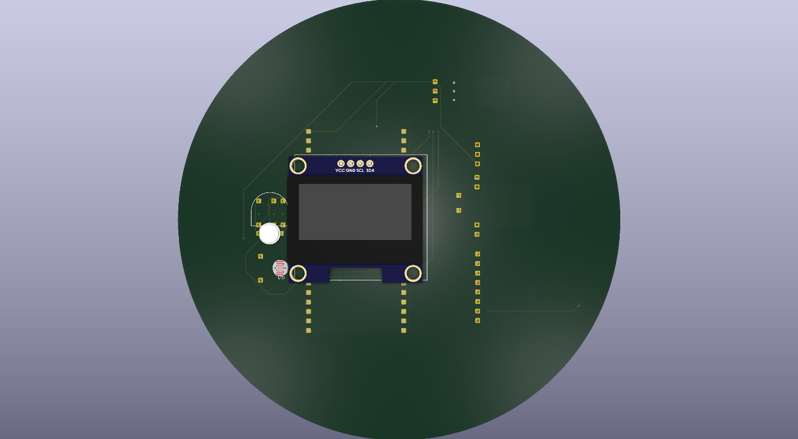
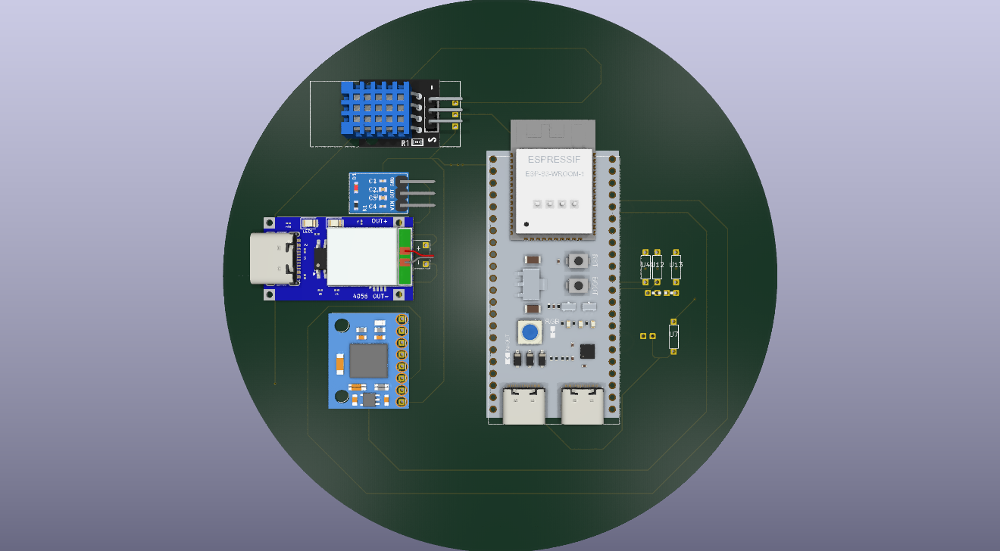

# The-smartest-paperweight

Hi there! Im happy to present you the smartest paperweight ever!

The name is an oxymoron bc esseantialy the project is a mere distraction or fun toy, not necesarrily something that adds any valua. (Unless it is crucial for you to read the weather through the very precise metric of digital googly eyes).

The project features:
~ A motion sensor (MPU6050) to detect when it is being picked up.
~ A RBG Led to change the mood of the pet (The case is meant to be translucent)
~ A Photoresistor to detect the surrounding light and turn off at night
~ A Temperature sensor for the very rigorous measurement of the weather
~ An ESP32 Brain to control the whole thing
~ A 100mAH LiOH battery with a TP 4056 for charging
~ An AMS1117 for power modulation

Here are some pictures of the project!

